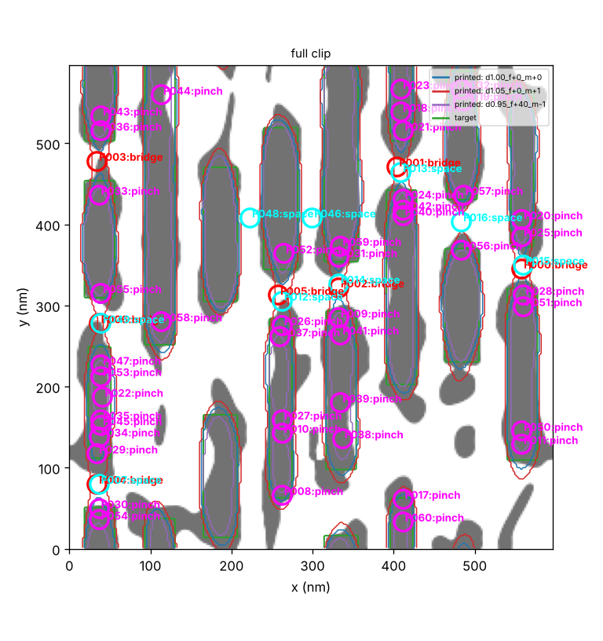
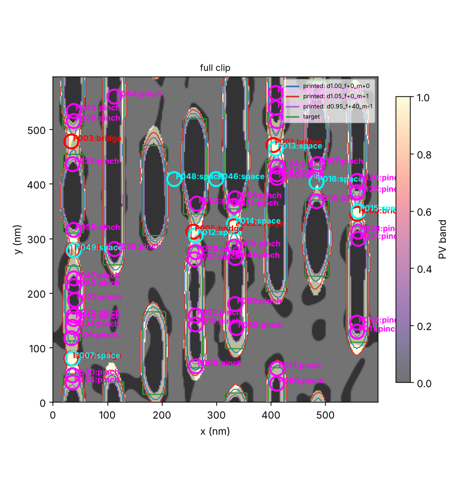
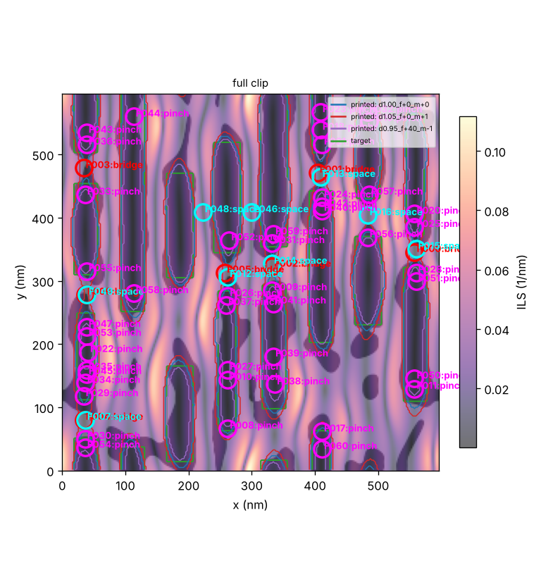
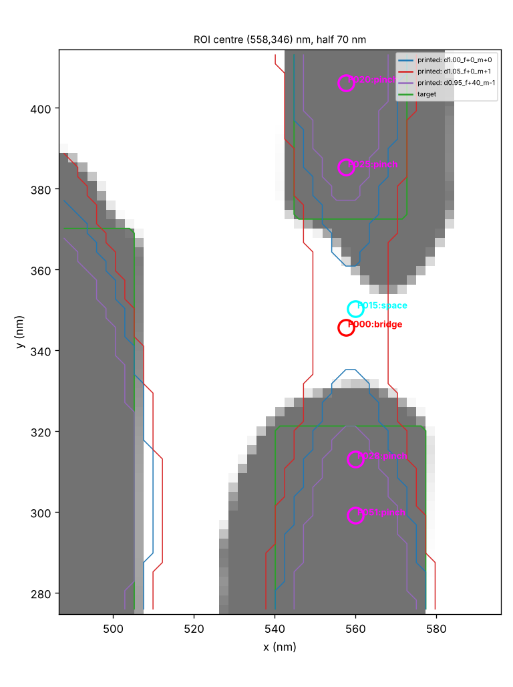
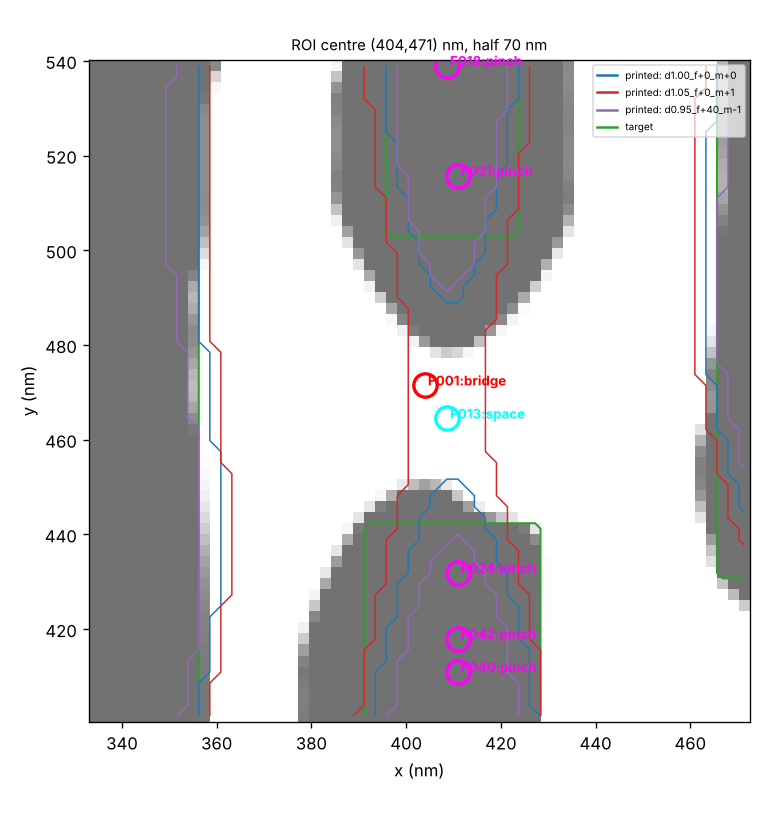
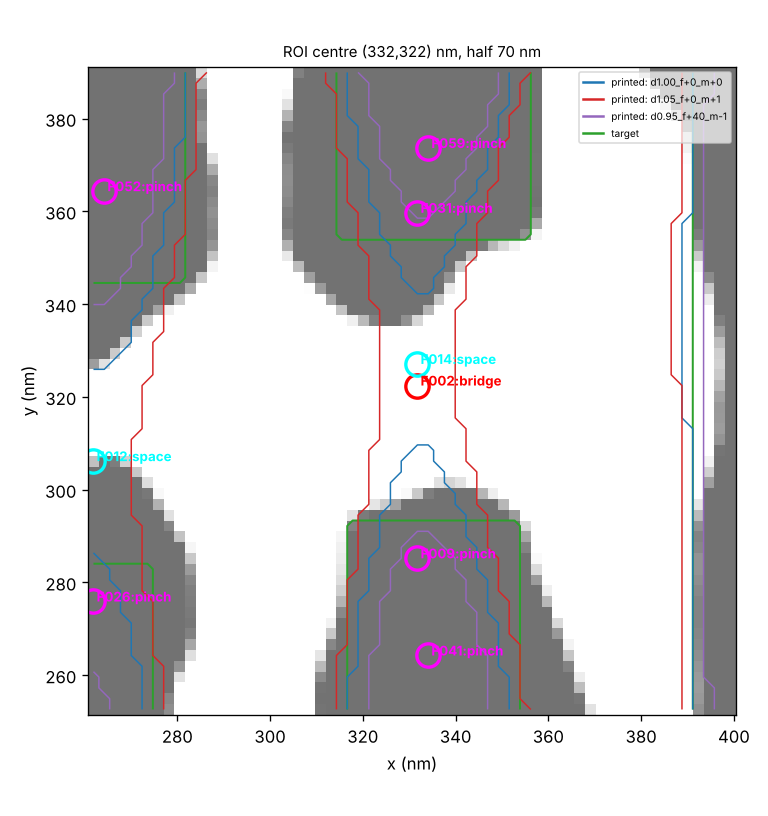
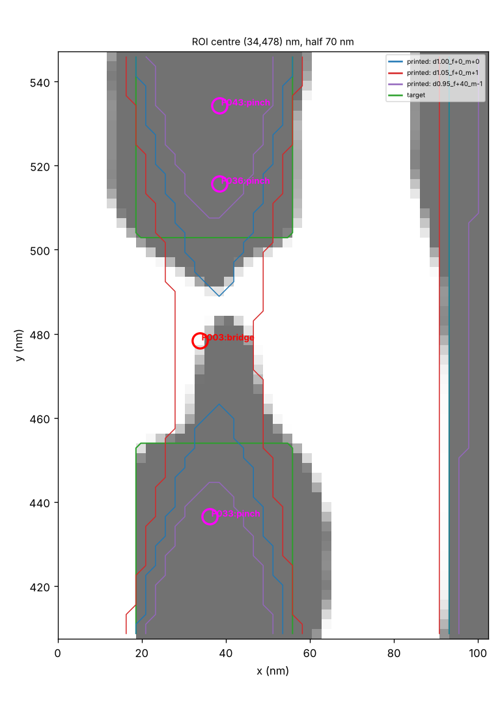
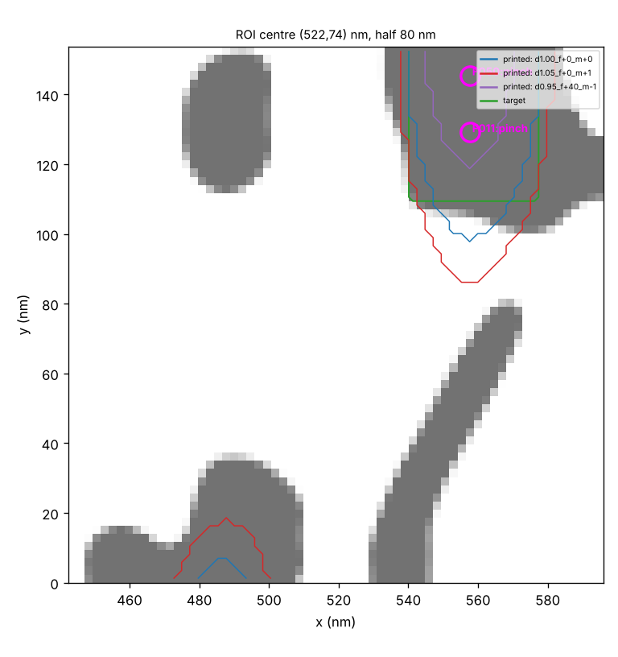
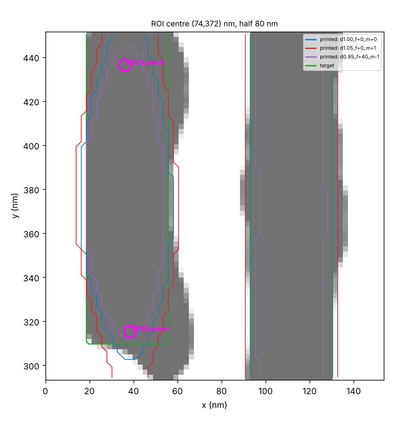

# ILT clip analysis

Extent 596 x 596 nm, pixel 2.328 nm, 27 process conditions (nominal: `d1.00_f+0_m+0`).

Spec: {"w_min_nm": 28.0, "s_min_nm": 28.0, "margin_nm": 2.0, "epe_tol_nm": 5.0, "mrc_width_nm": 10.0, "mrc_space_nm": 10.0, "mrc_area_nm2": 150.0, "merge_nm": 12.0, "border_nm": 30.0, "corner_nm": 12.0}

## 1. Global

| layer | count | area_total_nm2 | area_min_nm2 | vertices_median | compactness_median |
|---|---|---|---|---|---|
| target | 20 | 103227.06176757812 | 552.85693359375 | 164.0 | 2.0599702977232353 |
| mask | 25 | 149293.052734375 | 70.462158203125 | 183.0 | 2.365237841436581 |

Detached assist features on mask: 6; mask area outside target: 51166 nm2; printed/target area at nominal: 0.977.

## 2. Printability (all conditions)

Counts: `{"bridge": {"catastrophic": 7}, "space": {"violation": 9, "marginal": 10}, "pinch": {"violation": 45, "marginal": 31}, "epe": {"info": 30}}`; conditions with most findings: [('d1.00_f+0_m+0', 51), ('d0.95_f+0_m+1', 19), ('d0.95_f+40_m+0', 19), ('d0.95_f+40_m-1', 19), ('d0.95_f-40_m-1', 19)]

| id | type | level | x_nm | y_nm | value | n_conditions |
|---|---|---|---|---|---|---|
| F000 | bridge | catastrophic | 557.6 | 345.7 | 0.0 | 16 |
| F001 | bridge | catastrophic | 403.9 | 471.4 | 0.0 | 15 |
| F002 | bridge | catastrophic | 331.8 | 322.4 | 0.0 | 12 |
| F003 | bridge | catastrophic | 33.8 | 478.4 | 0.0 | 9 |
| F004 | bridge | catastrophic | 33.8 | 80.3 | 0.0 | 1 |
| F005 | bridge | catastrophic | 257.3 | 313.1 | 0.0 | 8 |
| F006 | bridge | catastrophic | 36.1 | 278.2 | 0.0 | 5 |
| F007 | space | violation | 36.1 | 80.3 | 4.66 | 3 |
| F008 | pinch | violation | 261.9 | 66.4 | 6.58 | 1 |
| F009 | pinch | violation | 331.8 | 285.2 | 9.31 | 11 |
| F010 | pinch | violation | 261.9 | 143.2 | 9.31 | 17 |
| F011 | pinch | violation | 557.6 | 129.2 | 9.31 | 4 |
| F012 | space | violation | 261.9 | 306.1 | 9.31 | 5 |
| F013 | space | violation | 408.6 | 464.5 | 13.97 | 4 |
| F014 | space | violation | 331.8 | 327.1 | 13.97 | 3 |
| F015 | space | violation | 559.9 | 350.4 | 13.97 | 3 |
| F016 | space | violation | 483.1 | 403.9 | 13.97 | 4 |
| F017 | pinch | violation | 410.9 | 61.7 | 14.72 | 1 |
| F018 | pinch | violation | 408.6 | 539.0 | 18.62 | 3 |
| F019 | pinch | violation | 485.4 | 552.9 | 18.62 | 9 |
| F020 | pinch | violation | 557.6 | 406.3 | 18.62 | 7 |
| F021 | pinch | violation | 410.9 | 515.7 | 18.62 | 5 |
| F022 | pinch | violation | 40.7 | 187.4 | 18.62 | 2 |
| F023 | pinch | violation | 408.6 | 566.9 | 18.62 | 1 |
| F024 | pinch | violation | 410.9 | 431.9 | 18.62 | 4 |

## 3. EPE and PV band

Nominal EPE: {'mean': 0.34, 'rms': 2.38, 'p99_abs': 7.56, 'frac_above_tol': 0.0433}; PV-band width along edges: {'median': 6.98, 'p95': 15.33, 'max': 58.94}; PV-band area / target area: 0.672.

| x_nm | y_nm | value_nm |
|---|---|---|
| 356.2 | 367.1 | -9.52 |
| 239.8 | 359.2 | -9.31 |
| 186.0 | 470.3 | 9.03 |
| 188.6 | 305.0 | 8.68 |
| 356.2 | 371.1 | -8.33 |
| 256.5 | 519.2 | 8.09 |
| 109.2 | 37.2 | 7.97 |
| 557.5 | 109.4 | 7.94 |

## 4. Mask rules

Rules {'min_width_nm': 10.0, 'min_space_nm': 10.0, 'min_area_nm2': 150.0}: width violations 81, space violations 16, small islands 1, sharp corners (r<4 nm) 31.

## 5. Regional view and anomalies

Tile 149.0 nm, 16 tiles. Feature medians: `{"target_density": 0.3704, "mask_density": 0.4978, "mask_target_xor": 0.1482, "epe_rms_nom": 3.5395, "epe_maxabs_nom": 9.7108, "pv_band_frac": 0.2179, "n_findings": 8.0, "mask_perimeter_per_area": 0.0581, "min_edge_ils": 0.0163}`

| x0_nm | y0_nm | x1_nm | y1_nm | score | n_findings | driving_features |
|---|---|---|---|---|---|---|
| 447.0 | 0.0 | 596.0 | 149.0 | 0.792 | 3.0 | ['pv_band_frac (|z|=3.5)', 'mask_perimeter_per_area (|z|=2.7)', 'target_density (|z|=2.5)'] |
| 0.0 | 298.0 | 149.0 | 447.0 | 0.722 | 8.0 | ['min_edge_ils (|z|=5.1)', 'mask_target_xor (|z|=1.9)', 'target_density (|z|=0.9)'] |
| 0.0 | 447.0 | 149.0 | 596.0 | 0.687 | 10.0 | ['epe_maxabs_nom (|z|=5.8)', 'epe_rms_nom (|z|=1.4)', 'pv_band_frac (|z|=1.1)'] |
| 298.0 | 447.0 | 447.0 | 596.0 | 0.674 | 7.0 | ['epe_maxabs_nom (|z|=6.0)', 'pv_band_frac (|z|=1.4)', 'min_edge_ils (|z|=0.7)'] |
| 298.0 | 298.0 | 447.0 | 447.0 | 0.516 | 17.0 | ['epe_maxabs_nom (|z|=3.4)', 'n_findings (|z|=3.0)', 'mask_target_xor (|z|=1.0)'] |

## 6. Hotspot pattern classes

| cluster | size | types | representative | members |
|---|---|---|---|---|
| 0 | 1 | {'bridge': 1} | F000 | F000 |
| 1 | 1 | {'bridge': 1} | F001 | F001 |
| 2 | 1 | {'bridge': 1} | F002 | F002 |
| 3 | 1 | {'bridge': 1} | F003 | F003 |
| 4 | 1 | {'bridge': 1} | F004 | F004 |
| 5 | 1 | {'bridge': 1} | F005 | F005 |
| 6 | 1 | {'bridge': 1} | F006 | F006 |
| 7 | 1 | {'space': 1} | F007 | F007 |
| 8 | 1 | {'pinch': 1} | F008 | F008 |
| 9 | 1 | {'pinch': 1} | F009 | F009 |
| 10 | 1 | {'pinch': 1} | F010 | F010 |
| 11 | 1 | {'pinch': 1} | F011 | F011 |
| 12 | 1 | {'space': 1} | F012 | F012 |
| 13 | 1 | {'space': 1} | F013 | F013 |
| 14 | 1 | {'space': 1} | F014 | F014 |
| 15 | 1 | {'space': 1} | F015 | F015 |
| 16 | 1 | {'space': 1} | F016 | F016 |
| 17 | 1 | {'pinch': 1} | F017 | F017 |
| 18 | 1 | {'pinch': 1} | F018 | F018 |
| 19 | 1 | {'pinch': 1} | F019 | F019 |
| 20 | 1 | {'pinch': 1} | F020 | F020 |
| 21 | 1 | {'pinch': 1} | F021 | F021 |
| 22 | 1 | {'pinch': 1} | F022 | F022 |
| 23 | 1 | {'pinch': 1} | F023 | F023 |
| 24 | 1 | {'pinch': 1} | F024 | F024 |
| 25 | 1 | {'pinch': 1} | F025 | F025 |
| 26 | 1 | {'pinch': 1} | F026 | F026 |
| 27 | 1 | {'pinch': 1} | F027 | F027 |
| 28 | 1 | {'pinch': 1} | F028 | F028 |
| 29 | 1 | {'pinch': 1} | F029 | F029 |
| 30 | 1 | {'pinch': 1} | F030 | F030 |
| 31 | 1 | {'pinch': 1} | F031 | F031 |
| 32 | 1 | {'pinch': 1} | F032 | F032 |
| 33 | 1 | {'pinch': 1} | F033 | F033 |
| 34 | 1 | {'pinch': 1} | F034 | F034 |
| 35 | 1 | {'pinch': 1} | F035 | F035 |
| 36 | 1 | {'pinch': 1} | F036 | F036 |
| 37 | 1 | {'pinch': 1} | F037 | F037 |
| 38 | 1 | {'pinch': 1} | F038 | F038 |
| 39 | 1 | {'pinch': 1} | F039 | F039 |
| 40 | 1 | {'pinch': 1} | F040 | F040 |
| 41 | 1 | {'pinch': 1} | F041 | F041 |
| 42 | 1 | {'pinch': 1} | F042 | F042 |
| 43 | 1 | {'pinch': 1} | F043 | F043 |
| 44 | 1 | {'pinch': 1} | F044 | F044 |
| 45 | 1 | {'pinch': 1} | F045 | F045 |
| 46 | 1 | {'space': 1} | F046 | F046 |
| 47 | 1 | {'pinch': 1} | F047 | F047 |
| 48 | 1 | {'space': 1} | F048 | F048 |
| 49 | 1 | {'space': 1} | F049 | F049 |
| 50 | 1 | {'pinch': 1} | F050 | F050 |
| 51 | 1 | {'pinch': 1} | F051 | F051 |
| 52 | 1 | {'pinch': 1} | F052 | F052 |
| 53 | 1 | {'pinch': 1} | F053 | F053 |
| 54 | 1 | {'pinch': 1} | F054 | F054 |
| 55 | 1 | {'pinch': 1} | F055 | F055 |
| 56 | 1 | {'pinch': 1} | F056 | F056 |
| 57 | 1 | {'pinch': 1} | F057 | F057 |
| 58 | 1 | {'pinch': 1} | F058 | F058 |
| 59 | 1 | {'pinch': 1} | F059 | F059 |
| 60 | 1 | {'pinch': 1} | F060 | F060 |

## 7. Close-ups

### F000 bridge at (557.6, 345.7) nm

worst width 4.7 nm, worst space 14.0 nm (spec {'w_min_nm': 28.0, 's_min_nm': 28.0}); mask outside target 0.143; edge ILS {'p5': 0.0146, 'median': 0.0398}

### F001 bridge at (403.9, 471.4) nm

worst width 4.7 nm, worst space 14.0 nm (spec {'w_min_nm': 28.0, 's_min_nm': 28.0}); mask outside target 0.13; edge ILS {'p5': 0.0181, 'median': 0.0424}

### F002 bridge at (331.8, 322.4) nm

worst width 4.7 nm, worst space 14.0 nm (spec {'w_min_nm': 28.0, 's_min_nm': 28.0}); mask outside target 0.147; edge ILS {'p5': 0.0114, 'median': 0.0378}

### F003 bridge at (33.8, 478.4) nm

worst width 4.7 nm, worst space 27.9 nm (spec {'w_min_nm': 28.0, 's_min_nm': 28.0}); mask outside target 0.134; edge ILS {'p5': 0.0159, 'median': 0.0416}

### anomaly pv_band_frac (|z|=3.5), mask_perimeter_per_area (|z|=2.7) at (521.5, 74.5) nm

worst width 9.3 nm, worst space 32.6 nm (spec {'w_min_nm': 28.0, 's_min_nm': 28.0}); mask outside target 0.197; edge ILS {'p5': 0.0121, 'median': 0.0311}

### anomaly min_edge_ils (|z|=5.1), mask_target_xor (|z|=1.9) at (74.5, 372.5) nm

worst width 23.3 nm, worst space 4.7 nm (spec {'w_min_nm': 28.0, 's_min_nm': 28.0}); mask outside target 0.083; edge ILS {'p5': 0.0397, 'median': 0.0419}

