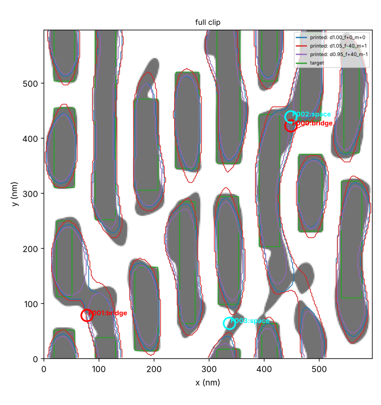
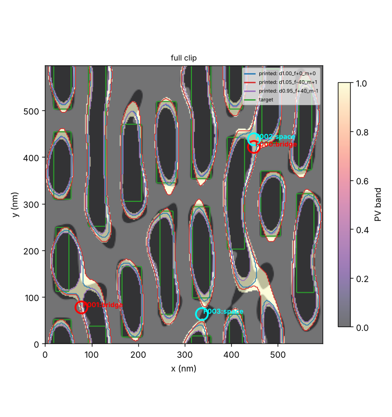
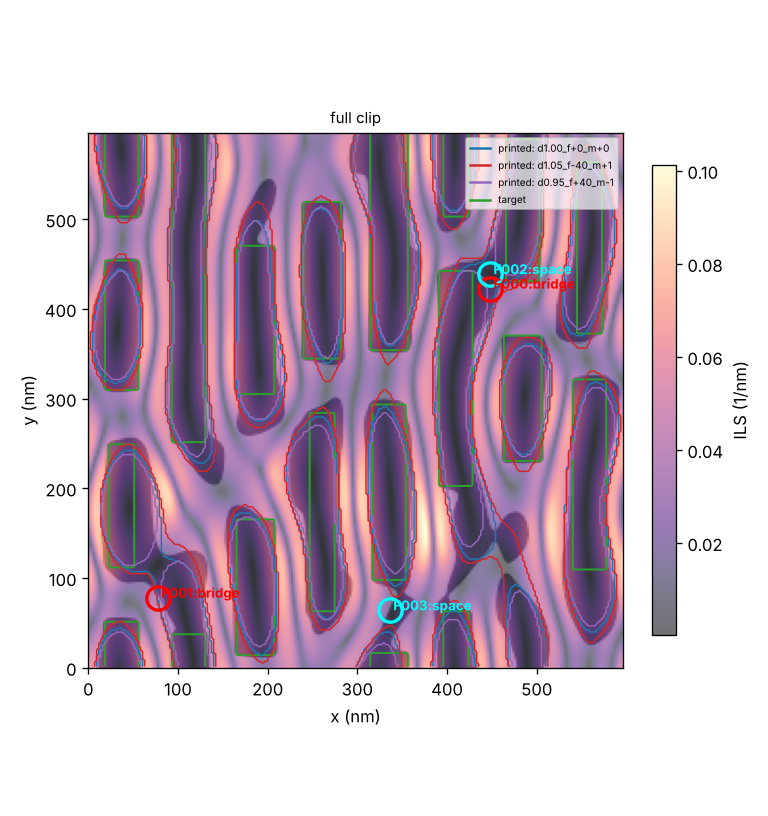
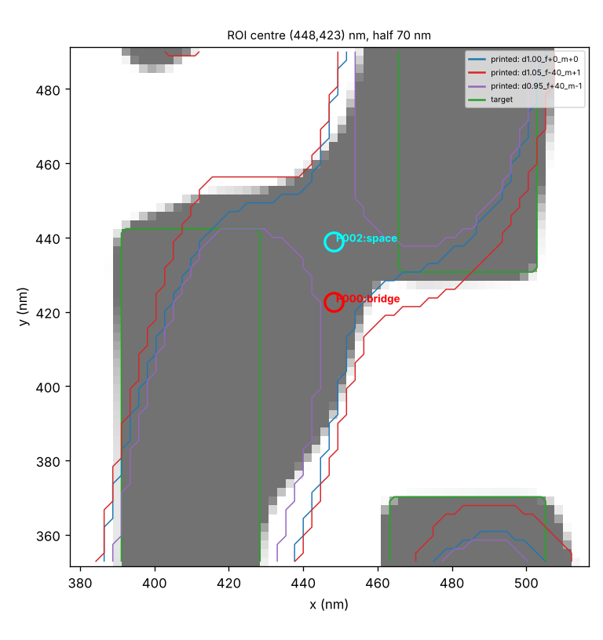
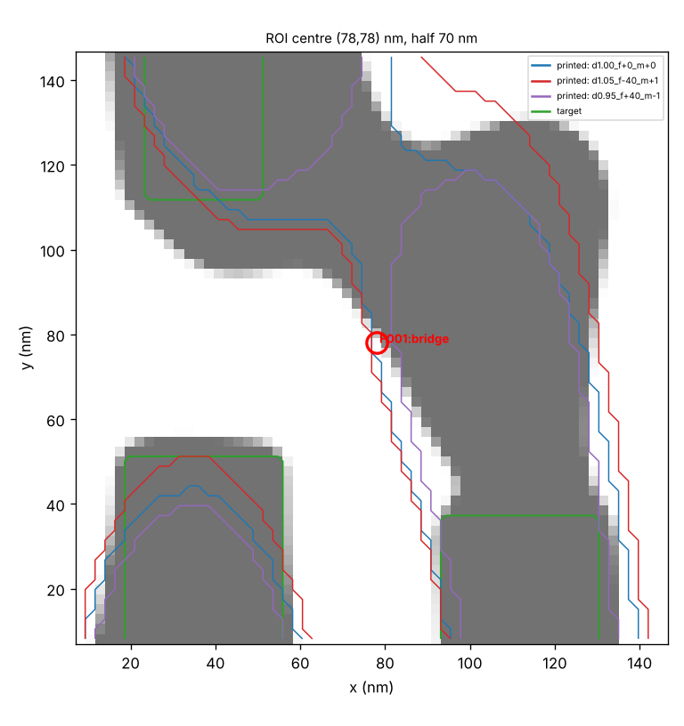
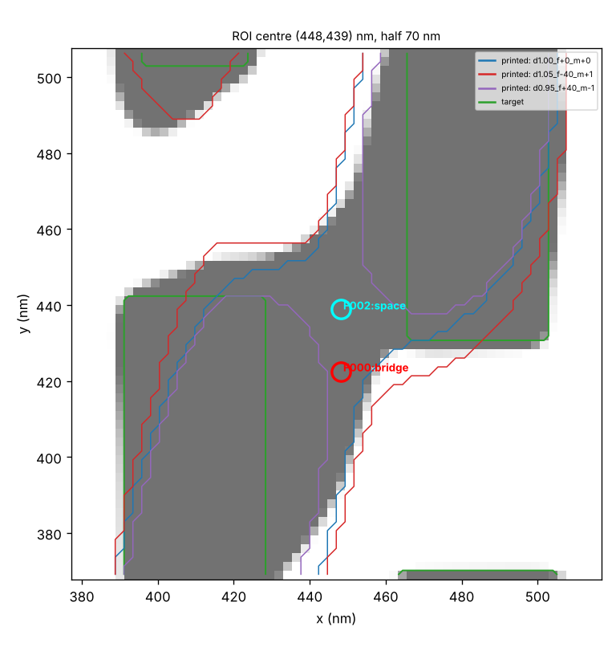
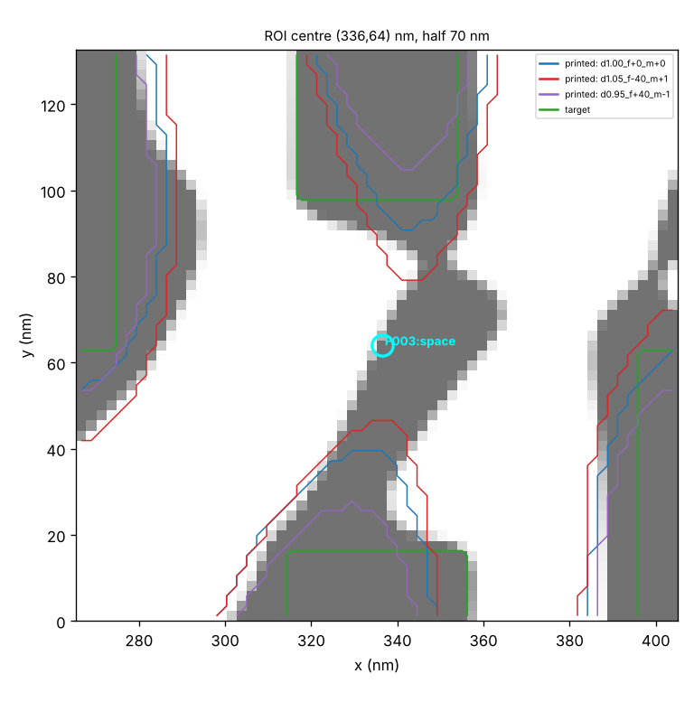
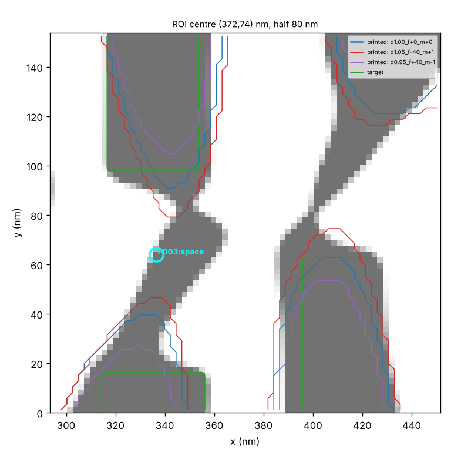
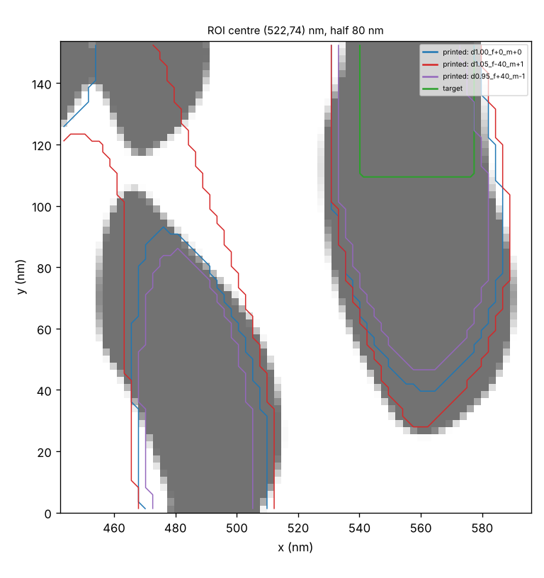

# ILT clip analysis

Extent 596 x 596 nm, pixel 2.328 nm, 27 process conditions (nominal: `d1.00_f+0_m+0`).

Spec: {"w_min_nm": 28.0, "s_min_nm": 28.0, "margin_nm": 2.0, "epe_tol_nm": 5.0, "mrc_width_nm": 10.0, "mrc_space_nm": 10.0, "mrc_area_nm2": 150.0, "merge_nm": 12.0, "border_nm": 30.0, "corner_nm": 12.0}

## 1. Global

| layer | count | area_total_nm2 | area_min_nm2 | vertices_median | compactness_median |
|---|---|---|---|---|---|
| target | 20 | 103227.06176757812 | 552.85693359375 | 164.0 | 2.0599702977232353 |
| mask | 17 | 166558.99157714844 | 2184.326904296875 | 212.0 | 2.420912828749849 |

Detached assist features on mask: 1; mask area outside target: 65221 nm2; printed/target area at nominal: 1.303.

## 2. Printability (all conditions)

Counts: `{"bridge": {"catastrophic": 2}, "space": {"violation": 2, "marginal": 32}, "pinch": {"marginal": 12}, "epe": {"info": 61}}`; conditions with most findings: [('d1.05_f+40_m+1', 24), ('d1.05_f+0_m+1', 21), ('d1.05_f-40_m+1', 20), ('d0.95_f-40_m-1', 6), ('d1.00_f+40_m+1', 6)]

| id | type | level | x_nm | y_nm | value | n_conditions |
|---|---|---|---|---|---|---|
| F000 | bridge | catastrophic | 448.2 | 422.6 | 0.0 | 22 |
| F001 | bridge | catastrophic | 78.0 | 78.0 | 0.0 | 17 |
| F002 | space | violation | 448.2 | 438.9 | 6.58 | 5 |
| F003 | space | violation | 336.4 | 64.0 | 23.28 | 2 |
| F004 | space | marginal | 220.0 | 271.2 | 26.34 | 5 |
| F005 | space | marginal | 525.0 | 359.7 | 26.34 | 4 |
| F006 | pinch | marginal | 264.2 | 359.7 | 27.15 | 12 |
| F007 | pinch | marginal | 343.4 | 103.6 | 27.15 | 3 |
| F008 | space | marginal | 373.7 | 511.0 | 27.15 | 3 |
| F009 | space | marginal | 294.5 | 506.4 | 27.15 | 3 |
| F010 | space | marginal | 450.5 | 348.1 | 27.15 | 1 |
| F011 | pinch | marginal | 112.9 | 380.6 | 27.94 | 2 |
| F012 | pinch | marginal | 487.7 | 564.6 | 27.94 | 2 |
| F013 | space | marginal | 445.8 | 324.8 | 27.94 | 4 |
| F014 | space | marginal | 147.8 | 310.8 | 27.94 | 4 |
| F015 | space | marginal | 445.8 | 315.5 | 27.94 | 2 |
| F016 | space | marginal | 376.0 | 390.0 | 27.94 | 6 |
| F017 | space | marginal | 222.3 | 403.9 | 27.94 | 3 |
| F018 | space | marginal | 301.5 | 422.6 | 27.94 | 1 |
| F019 | space | marginal | 222.3 | 427.2 | 27.94 | 3 |
| F020 | space | marginal | 369.0 | 543.6 | 27.94 | 2 |
| F021 | space | marginal | 80.3 | 552.9 | 27.94 | 1 |
| F022 | space | marginal | 520.3 | 480.8 | 27.94 | 3 |
| F023 | space | marginal | 75.7 | 357.4 | 27.94 | 3 |
| F024 | pinch | marginal | 336.4 | 364.4 | 27.94 | 2 |

## 3. EPE and PV band

Nominal EPE: {'mean': 3.4, 'rms': 8.12, 'p99_abs': 26.49, 'frac_above_tol': 0.3908}; PV-band width along edges: {'median': 6.54, 'p95': 11.39, 'max': 23.99}; PV-band area / target area: 0.578.

| x_nm | y_nm | value_nm |
|---|---|---|
| 51.2 | 153.7 | 30.0 |
| 51.2 | 157.7 | 29.99 |
| 51.2 | 149.7 | 29.42 |
| 51.2 | 161.7 | 28.79 |
| 51.2 | 145.7 | 28.61 |
| 51.2 | 165.7 | 28.12 |
| 51.2 | 169.7 | 27.94 |
| 51.2 | 173.7 | 27.94 |

## 4. Mask rules

Rules {'min_width_nm': 10.0, 'min_space_nm': 10.0, 'min_area_nm2': 150.0}: width violations 53, space violations 10, small islands 0, sharp corners (r<4 nm) 11.

## 5. Regional view and anomalies

Tile 149.0 nm, 16 tiles. Feature medians: `{"target_density": 0.3704, "mask_density": 0.5076, "mask_target_xor": 0.1681, "epe_rms_nom": 8.8187, "epe_maxabs_nom": 21.6327, "pv_band_frac": 0.1785, "n_findings": 6.0, "mask_perimeter_per_area": 0.0502, "min_edge_ils": 0.0166}`

| x0_nm | y0_nm | x1_nm | y1_nm | score | n_findings | driving_features |
|---|---|---|---|---|---|---|
| 298.0 | 0.0 | 447.0 | 149.0 | 0.811 | 4.0 | ['mask_perimeter_per_area (|z|=5.6)', 'pv_band_frac (|z|=1.7)', 'target_density (|z|=1.4)'] |
| 447.0 | 0.0 | 596.0 | 149.0 | 0.761 | 1.0 | ['mask_target_xor (|z|=3.1)', 'target_density (|z|=2.5)', 'pv_band_frac (|z|=2.2)'] |
| 149.0 | 447.0 | 298.0 | 596.0 | 0.644 | 7.0 | ['mask_perimeter_per_area (|z|=3.9)', 'mask_density (|z|=3.7)', 'target_density (|z|=1.6)'] |
| 0.0 | 149.0 | 149.0 | 298.0 | 0.453 | 5.0 | ['mask_density (|z|=1.7)', 'pv_band_frac (|z|=1.6)', 'epe_rms_nom (|z|=1.6)'] |
| 298.0 | 298.0 | 447.0 | 447.0 | 0.431 | 14.0 | ['n_findings (|z|=2.7)', 'mask_perimeter_per_area (|z|=2.4)', 'min_edge_ils (|z|=0.7)'] |

## 6. Hotspot pattern classes

| cluster | size | types | representative | members |
|---|---|---|---|---|
| 0 | 1 | {'bridge': 1} | F000 | F000 |
| 1 | 1 | {'bridge': 1} | F001 | F001 |
| 2 | 1 | {'space': 1} | F002 | F002 |
| 3 | 1 | {'space': 1} | F003 | F003 |

## 7. Close-ups

### F000 bridge at (448.2, 422.6) nm

worst width 4.7 nm, worst space 6.6 nm (spec {'w_min_nm': 28.0, 's_min_nm': 28.0}); mask outside target 0.186; edge ILS {'p5': 0.0114, 'median': 0.0303}

### F001 bridge at (78.0, 78.0) nm

worst width 4.7 nm, worst space 4.7 nm (spec {'w_min_nm': 28.0, 's_min_nm': 28.0}); mask outside target 0.357; edge ILS {'p5': 0.0166, 'median': 0.0361}

### F002 space at (448.2, 438.9) nm

worst width 4.7 nm, worst space 6.6 nm (spec {'w_min_nm': 28.0, 's_min_nm': 28.0}); mask outside target 0.207; edge ILS {'p5': 0.0114, 'median': 0.0302}

### F003 space at (336.4, 64.0) nm

worst width 25.1 nm, worst space 23.3 nm (spec {'w_min_nm': 28.0, 's_min_nm': 28.0}); mask outside target 0.23; edge ILS {'p5': 0.0163, 'median': 0.0264}

### anomaly mask_perimeter_per_area (|z|=5.6), pv_band_frac (|z|=1.7) at (372.5, 74.5) nm

worst width 25.1 nm, worst space 16.8 nm (spec {'w_min_nm': 28.0, 's_min_nm': 28.0}); mask outside target 0.233; edge ILS {'p5': 0.0142, 'median': 0.0303}

### anomaly mask_target_xor (|z|=3.1), target_density (|z|=2.5) at (521.5, 74.5) nm

worst width 10.4 nm, worst space 13.2 nm (spec {'w_min_nm': 28.0, 's_min_nm': 28.0}); mask outside target 0.424; edge ILS {'p5': 0.0074, 'median': 0.033}

