# ILT 中 bridge / pinch 矛盾:recipe 层面论点的数值验证报告

> 场景:193i,NA 1.35,单向 metal,full pitch 74.5 nm(接近单次曝光截止 pitch 71.5 nm)。
> 范围:**模型固定**,只研究 recipe(cost、工艺角、自由度、优化器、检查器)能做什么。
> 代码:`ilt_study/`(README 有模型与复现方法)。所有数字来自本目录 `results/*.json`,图在 `figures/`。

## 0. 先说清楚:这些论点的来源

前几轮对话里给出的调参分析,**不是来自现场经验,也不是来自我做过的实验**(我没有任何过往实验记录)。它们来自三处:一阶成像推导、数值优化的通用理论(惩罚法、Pareto、步长)、少量 ILT/OPC 文献。这份报告把它们逐条写成可证伪的数值实验。结果是:**有的被支持,有的需要修正,有的被推翻**。下面每条都标注了状态。

状态标签:
- ✅ **支持**:实验结果与论点一致,且在多个版图上可复现
- ⚠️ **部分支持 / 需修正**:方向对,但有重要的前提条件,或者原表述过于简单
- ❌ **推翻**:实验结果与论点不符
- ○ **未验证**:只有推理或文献,没有做实验

## 核心结论(按对你的问题的重要性排序)

1. **最大的杠杆是主图形能偏离目标多远,而不是 SRAF 冻不冻结。** 不放任何 SRAF,只把主图形周围允许修改的范围从 14 nm 放宽到 40 nm,hotspot 就降到与全自由相当(6/14/14 → 3/8/4)。收益几乎都在 line-end,形式是与主图形相连的外扩,独立 SRAF 几乎没被用到。(E7、E7b、E7c、E8)
2. **把 mask CD 误差角放进优化,是最划算的单项 cost 改动。** 在 ±1 nm mask 误差下,hotspot 从 43~53 降到 4~7。在这个 pitch 下,mask 误差 × MEEF 是余量预算的大头。(E12、E1b)
3. **用站点级铰链,不要用全局面积型或始终施压的惩罚。** 后两种在所有权重下都只是在 bridge 和 pinch 之间搬运;铰链型在权重跨 125 倍时,两类都很低。(E4)
4. **只动 mask 图形时,对比度确实挖不动;但光源和 mask 类型能实实在在地提高对比度,同时降低 MEEF。** 在二元 mask、光源固定、剂量固定的前提下,ILT 无法提高 NILS;"窄 mask + 高剂量"会被 MEEF 吃掉,cost 里加对比度项也无效(E1、E1b、E11)。但如果把光源修剪到"0 级和 1 级都能进光瞳"的区域(去掉只贡献背景的点),NILS 从 1.91 升到 2.47,MEEF 从 1.55 降到 1.06,随机版图上的 hotspot 从 16 降到 5;再加上 attPSM 6%,hotspot 降到 1。(E16)
5. **"调遍权重都修不好"不等于无解。** 对孤立冲突,minimax 找到了加权和在 3~300 所有权重下都找不到的可行解;但整版套用会把违规挤到别处,应作为局部修补工具使用。悬崖型约束(T2T 短路)绝对不能 cap。(E5b、E15)
6. **T2T 与 line-end 回缩是不对称的冲突。** T2T 一侧是悬崖,剂量灵敏度是横向的 3 倍,偏置不守恒,不应追求"两边余量相等"。(E2、E3)
7. **评价方法本身很容易出错。** PV-band 可以一直下降而缺陷不变;cut 型检查器会漏掉绕开 cut 的桥接;用采样计数测灵敏度会把相关系数从 1.0 压到 0.4;热启动后继续优化本身就会修 21 个、坏 20 个。(E14、E3、E13)
8. **被推翻的建议:** 用梯度余弦标出无解位置(E6)、"节距延续式"规则 SRAF bar(E7)、在 cost 里加对比度项(E11)。

## 1. 实验平台(简述)

| 项目 | 设定 |
|---|---|
| 成像 | 标量 Abbe → SOCS(13 个核,与 Abbe 相比最大误差 0.06%),λ=193 nm,NA=1.35,浸没 n=1.44,非傍轴离焦相位 |
| 光源 | leaf 形 X-dipole:σx∈[0.90,1],\|σy\|≤0.30,即 74.5 nm pitch 的 0 级与 ±1 级能同时通过光瞳的区域 |
| Resist | 5 nm 高斯 blur + 常阈值,按 37/37.5 密集光栅在 mask=目标时印到尺寸来标定 |
| Mask | 薄 mask、二元暗场(亮 = trench = metal 线) |
| 版图 | 596 nm 周期 clip,8 条 track;随机单向 metal(线宽 30/37/44 nm,tip-to-tip 50~140 nm,部分空 track),另有手工构造的冲突版图 |
| ILT | 像素参数化:θ→sigmoid→锥形滤波(半径 R,作 MRC 代理)→tanh 投影;mask 偏置角用 ρ+b\|∇ρ\| 实现;默认用 Adam |
| 优化工艺角 | 名义角 + {剂量 1.05,mask +1 nm} 与 {剂量 0.95,mask −1 nm},各在焦距 0、±40 nm 下 |
| 检查器 | 硬 mask(亚像素抗锯齿),**3×3×3 全因子工艺角**:剂量 ±5%、焦距 ±40 nm、mask 每边 ±1 nm |
| 判据 | pinch:线宽 ≥ 28;横向 bridge:间距 ≥ 28;tip-to-tip:gap ≥ 30(3 条平行 cut);对角(line-end 到相邻线侧边)≥ 28;line-end 回缩 ≤ 15 nm;外加拓扑检查(印刷连通域合并两个目标 = bridge,断开或缺失 = open,与目标不接触的印刷 = SRAF 打印) |
| 参考 recipe "GOOD" | 保真度 1 + 站点铰链(bridge 10,pinch 10)+ SRAF 不打印 50,300 次迭代 |

参考 recipe 在 6 个随机版图上的结果:残余 hotspot 2~13 个;纯保真度 ILT 是 112~142 个。

## 2. 结论总表

| # | 论点(来自前几轮回答) | 实验 | 状态 | 一句话结果 |
|---|---|---|---|---|
| 1 | 74.5 nm pitch 的密集像只能是余弦,NILS 有上限,不可能做成方波 | E1 | ✅ | 二次谐波 0.3%(来自数值截断),三次谐波 0;NILS 与 πγ 吻合到 1% 以内;ILT 专门最大化对比度也只把 NILS 从 1.99 推到 2.01 |
| 2 | 抬高对比度/NILS 就能同时降低 bridge 与 pinch | E1b、E11、E16 | ⚠️ | 取决于用什么手段抬:"窄 mask + 高剂量"会推高 MEEF(余量 +8.2→+0.4);cost 里加对比度项无效;**修剪光源、换用 attPSM 能同时抬高 NILS、降低 MEEF**,hotspot 16→5→1 |
| 3 | 偏置只能在 bridge/pinch 之间重新分配余量,余量之和不变 | E2 | ⚠️ | 横向:在 ±1 nm 内成立,ILT 解已在平衡点上;沿 track 方向(T2T/line-end)不成立,T2T 一侧是悬崖 |
| 4 | 漂移 = 扰动/ILS,所以余量预算由局部斜率决定 | E3 | ✅ | 1279 个站点,相关系数 0.99~1.00,斜率 0.98~1.02;T2T 的剂量灵敏度是横向站点的 3 倍 |
| 5 | 全局/始终施压的 bridge 惩罚会把 mask 整体推小,产生 pinch;站点铰链不会 | E4 | ✅ | 面积型:bridge 107→0 时 pinch 25→220;线性型:在权重 2~8 之间翻转;铰链型:权重跨 125 倍,两类都 ≤12 |
| 6a | 无解位置在加大权重时变成"梯度黑洞",拖坏邻居 | E5b、E15 | ⚠️ | 孤立冲突时不成立(占梯度 50%~66%,邻居 0 新增);冲突密集的版图上,对所有冲突组集中加大权重后,组外违规 10→26 |
| 6b | 对无解位置做 cap 可以止损 | E5、E5b | ❌ | 全局 cap 冻结了所有大违规(新增 66~76 个);只对这对站点 cap,T2T 直接塌成桥接(−30) |
| 6c | "调遍权重都修不好" ⇒ 无解 | E5b、E15 | ❌ | **minimax 在孤立冲突上找到了两边都满足的解**(gap 38:+4.0/+0.5),加权和在所有权重下都找不到;但整版套用时,组内 31→17,组外 10→26,总数不变 |
| 7 | bridge/pinch 梯度余弦 ≈ −1 可以标出无解位置 | E6 | ❌ | 所有站点对的余弦都是负的(−0.42~−0.73),违规对只略微更负,不能当判据 |
| 8 | 释放冻结的 SRAF 能显著减少 hotspot | E7、E7b、E7c | ⚠️ | 释放外围自由度确实有效(14→4~8),但**收益来自与主图形相连的外扩**(line-end 翼状/hammerhead、mask 上的亚分辨率连接),独立 SRAF 几乎没被用到;不放 SRAF、只把可修改范围放宽到 40 nm,就能达到全自由的水平 |
| 9 | 逐级松弛能把每个 hotspot 归因到瓶颈自由度 | E8 | ✅ | 114 个违规:74% 靠 +SRAF/外围自由度修好,16% 靠放松 MRC,9% 靠收窄工艺角,2% 始终修不好 |
| 10 | 加大权重 = 加大步长,会振荡 | E9 | ⚠️ | 对普通梯度下降成立(×100 过冲,hotspot 33);对 Adam 不成立(×1/×10/×100 结果完全相同) |
| 11 | sigmoid 太陡梯度饱和,太软测量失真 | E10 | ⚠️ | 太软危害很大(偏差 5 nm,hotspot 81~92);太陡几乎无害 |
| 12 | 把 mask 误差角放进优化,能降低 MEEF、对 mask 误差更稳健 | E12 | ✅ | ±1 nm mask 误差下 hotspot 从 43~53 降到 4~7,MEEF 中位数降约 10% |
| 13 | 只对违规站点加权(检查器→cost 闭环)比全局加权更好、连带损伤更少 | E13 | ⚠️ | 略好(29 vs 33,连带 10 vs 12);但原 recipe 继续跑也会修 21 个、坏 20 个,噪声很大 |
| 14 | cost 与检查器不一致时,cost 改善不等于缺陷减少 | E14 | ✅/⚠️ | PV-band cost 降了 12%,hotspot 停在 78~80 不动;对齐 T2T 采样后,T2T 违规 15→4,但总数不变(转移成回缩) |

## 3. 逐条结果

### 3.1 E1:74.5 nm pitch 下像只能是余弦 ✅
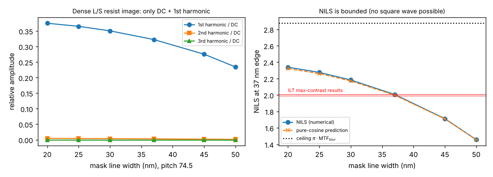

- 对 mask 线宽 20~50 nm 的密集光栅,resist 像的一次谐波与直流之比为 0.23~0.38,二次谐波 ≤0.0045(来自 SOCS 截断),三次谐波为 0。
- NILS(37 nm 边缘)的数值结果与余弦公式 πγ·sin/(1+γcos) 的差异 ≤1%。
- 理论上限:π × blur MTF(0.915)= 2.87。实际:37 nm mask 时 NILS = 2.0。
- 让 ILT 最大化最差角的 log-contrast(权重 0/1/10):NILS 为 1.99/2.01/2.01,谐波构成不变。

**含义:** 在这个 pitch 下,ILT 无法创造对比度,只能在一个固定的对比度预算内重新分配。

### 3.2 E1b + E11:"抬对比度"并不等于"同时修好" ❌/⚠️
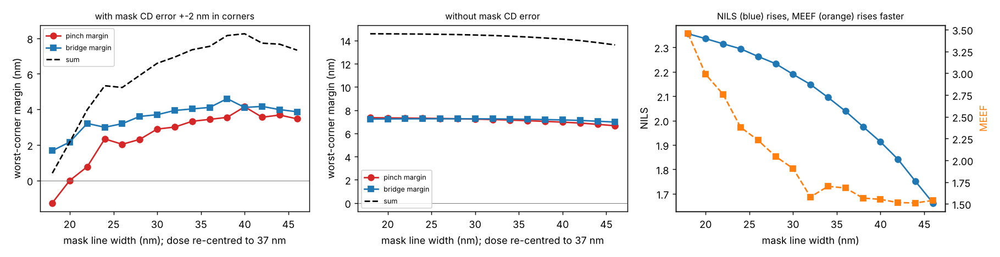

E1b 的做法:几何不变(37 nm 线),改变 mask 线宽,同时重新居中剂量,使印刷线宽仍为 37 nm。

| mask 线宽 | 剂量 | NILS | MEEF | 最差 pinch 余量 | 最差 bridge 余量 | 余量之和 |
|---|---|---|---|---|---|---|
| 18 | 3.52 | 2.36 | 3.45 | −1.26 | +1.67 | **+0.41** |
| 24 | 2.12 | 2.29 | 2.38 | +2.34 | +2.99 | +5.33 |
| 30 | 1.43 | 2.19 | 1.91 | +2.89 | +3.70 | +6.59 |
| 38 | 0.97 | 1.98 | 1.57 | +3.55 | +4.60 | **+8.15** |
| 46 | 0.72 | 1.66 | 1.54 | +3.47 | +3.86 | +7.33 |

- 若从工艺角里去掉 mask 误差,NILS 升高 40%,余量之和只增加 1 nm(13.6 → 14.6)。
- 线宽变化范围的分解(37 nm 线):剂量 ±5% 带来 3.8 nm,焦距 ±40 nm 带来 0.5 nm,mask ±2 nm 带来 5.9 nm。改用 20 nm mask 后,mask 项升到 12.1 nm。
- 两束光成像下,密集线几乎对焦距不敏感。

E11 的做法:在 cost 中加入最差角 log-contrast 项(权重 0/0.3/3/30)。剂量灵敏度只降约 2%,hotspot 为 5→6、7→9、4→3,没有改善。

**修正后的说法:** 真正决定余量的是总边缘漂移 ≈ 剂量项/ILS + MEEF×mask 误差 + 焦距项。在这个场景里 mask 项占主导。用偏置去换 NILS 会推高 MEEF,得不偿失。ILT 在固定剂量和目标尺寸下没有可挖的对比度空间。**你的直觉(要高对比度)在物理上没错,但 NILS 不是该优化的那个量,该优化的是包含 MEEF 的总漂移。**

### 3.3 E2:偏置只是重新分配余量 ⚠️
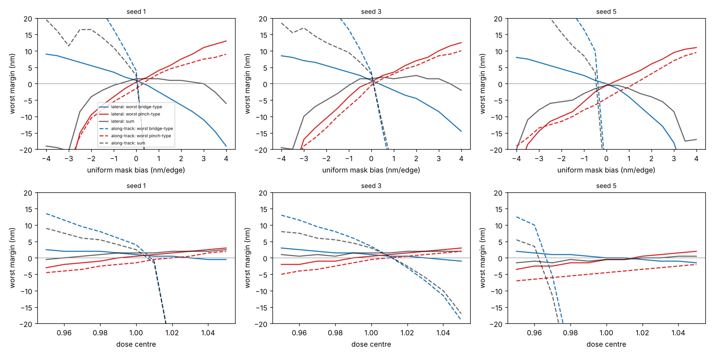

- **横向**(bridge vs 相邻 pinch):在 ±1 nm 偏置内,最差余量之和的变化 ≤2 nm(测量量化为 0.5 nm)。bridge 与 pinch 的余量曲线在 b≈0 处交叉,即 ILT 的解已经落在平衡点上。偏置往任一方向都只会减小余量之和,超出线性区后则急剧下降。
- **沿 track 方向**(T2T vs line-end 回缩):余量之和**不守恒**。T2T 一侧是悬崖:+0.5 nm 偏置就让最差 T2T 余量从 +4 跳到约 −30(gap 完全闭合)。剂量中心扫描的结果相同。
- 原因见 E3:T2T 的灵敏度是横向的 3 倍,而且失效是"拓扑性"的(两条线连在一起),不是渐变的。

**修正:** 对悬崖型失效(T2T 短路),不应该追求"两边余量相等",而应该给悬崖一侧留更多余量,让渐变的一侧(回缩)吸收误差。E5 观察到,ILT 在 gap 缩小时会自动这样做。

### 3.4 E3:漂移 = 扰动/ILS ✅
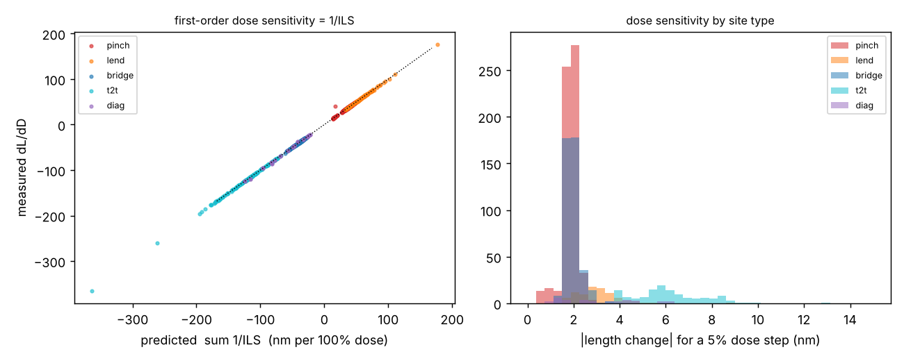

| 站点类型 | 数量 | 相关系数 | 拟合斜率 | 中位剂量灵敏度(nm/100%) |
|---|---|---|---|---|
| pinch | 611 | 0.990 | 0.98 | 38 |
| 横向 bridge | 417 | 1.000 | 1.00 | 38 |
| line-end | 87 | 1.000 | 1.00 | 58 |
| 对角 | 33 | 0.999 | 1.02 | 57 |
| T2T | 131 | 1.000 | 1.00 | **118** |

(需要亚采样插值测量;用 0.5 nm 采样计数时,相关系数只有约 0.4。这是一个测量方法上的坑。)

### 3.5 E5 / E5b:无解位置与"梯度黑洞"
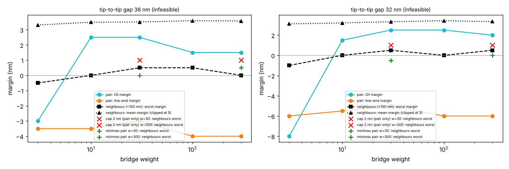

设置:conflict 版图,第 3 条 track 上 tip-to-tip gap 从 60 缩到 32 nm。用参考 recipe 扫描 bridge 权重(3/10/30/100),看 T2T 余量和 line-end 余量。

E5 第一步(gap 扫描,加权和形式):

| gap (nm) | 所有权重下 T2T 余量 | 所有权重下 line-end 余量 |
|---|---|---|
| 60 | +4.0 ~ +6.0 | +0.5 |
| 50 | +3.0 ~ +4.0 | −1.0 ~ 0.0 |
| 44 | +0.5 ~ +4.0 | −2.0 ~ −1.5 |
| 38 | −3.0 ~ +2.5 | −4.0 ~ −3.0 |
| 32 | −8.0 ~ +2.5 | −6.0 ~ −5.0 |

- 随着 gap 缩小,ILT 自动保住悬崖一侧(T2T),让渐变一侧(回缩)吸收违规。
- E5 的原始脚本有一个 bug:选点逻辑把余量 0.0 当成"无解",选中了临界可行的 gap 50;而且它的 cap 是全局的。E5b 修掉了这两个问题。

E5b(gap 38 与 32;邻居 = 距这对站点 150 nm 以内的其他站点):

| gap | 配置 | T2T | line-end | 邻居违规数 | 邻居平均余量 |
|---|---|---|---|---|---|
| 38 | 加权和,w=3 | −3.0 | −3.5 | 1 | 3.3 |
| 38 | 加权和,w=10~300 | +1.5 ~ +2.5 | −4.0 ~ −3.0 | 0 | 3.5~3.6 |
| 38 | 只对这对 cap 2 nm | **−30** | +34 | 0 | 3.8 |
| 38 | minimax,w=30 | +1.5 | −1.5 | 0 | 3.4 |
| 38 | minimax,w=300 | **+4.0** | **+0.5** | 0 | 3.7 |
| 32 | 加权和,w=10~300 | +1.5 ~ +2.5 | −6.0 ~ −5.0 | 0 | 3.2~3.4 |
| 32 | 只对这对 cap 2 nm | **−30** | +31 | 0 | 3.9 |
| 32 | minimax,w=300 | **+1.0** | **0.0** | 0 | 3.5 |

结论:
1. ❌ **"梯度黑洞"在这里不成立。** 这对站点吃掉了一半以上的梯度,但邻居不受影响。原因可能是:光学影响半径有限(约 100 nm),邻居有自己的自由度,而 Adam 会按像素归一化步长。但在冲突密集的随机版图上,对所有冲突组集中加大权重时,确实出现了连带损伤(见 §3.15)。
2. ❌ **cap 是危险的。** 全局 cap 会让优化初期所有大违规失去梯度;只对这一对 cap 时,悬崖一侧会直接塌掉。**悬崖型约束不能 cap。**
3. ❌ **"加权和调不出来"不等于无解。** 对加权和来说,两个违规此消彼长,最优点停在一个折中处;minimax 只推当前最差的那一个,结果找到了两边都满足的点。这是多目标优化的经典结论:加权和到不了 Pareto 前沿的非凸部分,Chebyshev/minimax 形式可以。
4. **实用流程:** 先用 minimax/epigraph 形式在局部重新优化;如果仍然修不好,再走逐级松弛(E8)去找瓶颈;最后才判定为无解并反馈设计。

### 3.6 E4:全局 vs 站点铰链 ✅
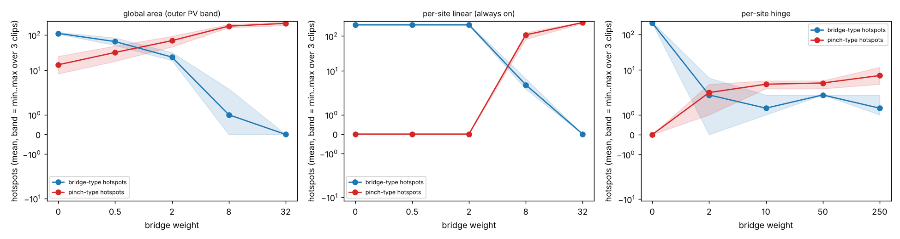

三个随机版图,固定 pinch 保护,只扫描 bridge 权重:

| 写法 | 权重扫描 | bridge hotspot | pinch hotspot |
|---|---|---|---|
| 全局面积(外侧 PV-band) | 0 → 32 | 107/119/106 → 0 | 25/10/8 → 220/185/233 |
| 站点线性(始终施压) | 0 → 32 | 2 与 8 之间突然翻转:≈200 → 3~6 | 0 → 81~126 |
| 站点铰链 | 2 → 250 | 0~6 | 1~12 |

- 全局面积型和线性型在整个扫描范围内都**没有一个点能让两类都低**,只是在搬运。
- 铰链型在 125 倍的权重范围内都稳定。只有在最高权重(250)时,pinch 略有上升(4→5,5→12,3→4),这是少量残余竞争。
- **机制:** 铰链在余量达标的位置梯度为零,所以安全的位置不会被推向另一种缺陷。

### 3.7 E6:梯度余弦不能当无解判据 ❌
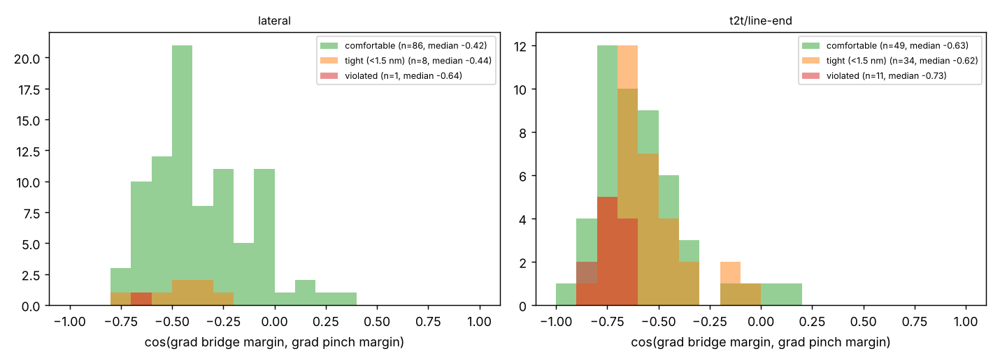

| 站点对 | 宽松 | 紧张(<1.5 nm) | 违规 |
|---|---|---|---|
| 横向 | −0.42(n=86) | −0.44(n=8) | −0.64(n=1) |
| T2T/line-end | −0.63(n=49) | −0.62(n=34) | −0.73(n=11) |

bridge 与 pinch 共享同一条边,几何上处处反向耦合;另外在约束最优点,KKT 条件本身也要求活跃约束的梯度反向。所以余弦反映的是耦合,不是可行性。**判断无解要用扫描(E2/E5)或逐级松弛(E8)。**

### 3.8 E7 / E7b:SRAF 与外围自由度
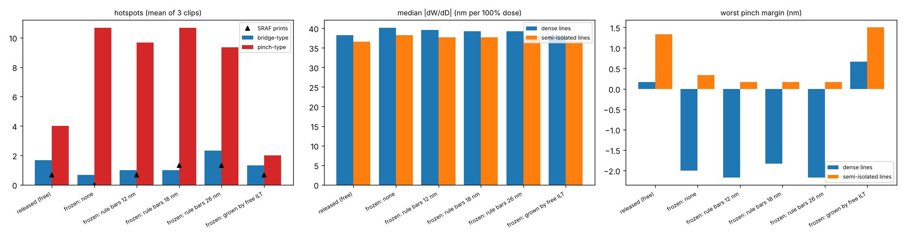
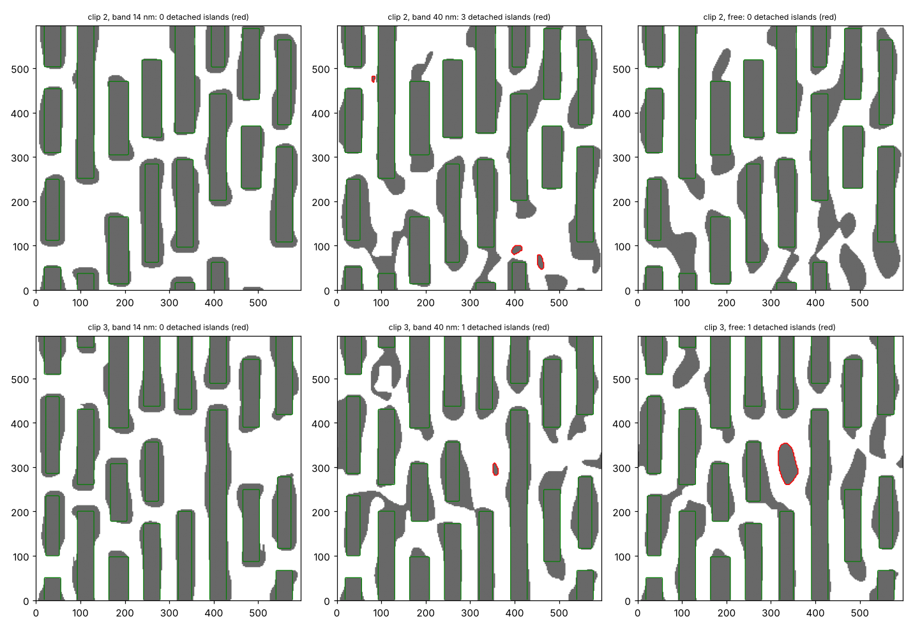

**E7b(不放 SRAF,只改变主图形周围允许修改的范围):**

| 可修改范围 | hotspot(3 个版图) | 其中 line-end |
|---|---|---|
| 8 nm | 21 / 40 / 43 | 10 / 16 / 16 |
| 14 nm | 6 / 14 / 14 | 5 / 11 / 9 |
| 25 nm | 4 / 11 / 8 | 4 / 8 / 5 |
| 40 nm | **3 / 8 / 4** | 3 / 4 / 3 |
| 全自由 | 5 / 7 / 4 | 4 / 4 / 3 |

**E7c(mask 上长出来的是什么):** 统计与任何目标都不相连的 mask 岛(即传统意义上的 SRAF):

| 版图 | 范围 14 nm | 范围 40 nm | 全自由 |
|---|---|---|---|
| seed2:独立岛数量 / 面积 | 0 / 0 | 3 / 764 nm² | 0 / 0 |
| seed3:独立岛数量 / 面积 | 0 / 0 | 1 / 255 nm² | 1 / 2959 nm² |
| 与主图形相连的外扩面积 | ≈55 000 nm² | ≈60 000 nm² | ≈57 000~65 000 nm² |

**对 E7 的修正解读:**
- 释放外围自由度带来的收益,主要不是独立 SRAF 带来的,而是主图形**被允许外扩到距目标 15~40 nm 的地方**:line-end 的翼状结构、hammerhead,以及 mask 上把相邻线条连起来、但印不出来的亚分辨率连接(见上图右列)。
- E7 里"自由生长后冻结"那组,冻结的主要是这些相连的外扩部分。
- 在你的流程里,这对应的不是"SRAF 冻不冻结",而是这些参数:**主图形/fragment 的最大移动量、主图形区域的宽度、SRAF 与主图形的最小间距、是否允许 mask 上不同线条相连**。在本模型里,它们是最大的单项杠杆。
- 现实中的 mask 规则或签核可能不允许这些连接,或者对它们另有限制。这正是一个需要和 mask/MRC 团队一起评估的取舍。

E7(3 个版图;冻结区 = 距目标 14 nm 以外):

| 配置 | hotspot(3 个版图) | 其中 line-end | SRAF 打印 |
|---|---|---|---|
| 释放(全自由) | 5 / 8 / 4 | 4 / 4 / 3 | 0~1 |
| 冻结:无 SRAF | 6 / 14 / 14 | 5 / 11 / 9 | 0 |
| 冻结:规则 bar 12 nm | 7 / 13 / 12 | 5 / 9 / 7 | 0~1 |
| 冻结:规则 bar 18 nm | 8 / 14 / 13 | 6 / 10 / 8 | 1~2 |
| 冻结:规则 bar 26 nm | 6 / 14 / 15 | 4 / 9 / 8 | 1~2 |
| 冻结:自由 ILT 生长后二值化 | **4 / 3 / 3** | 3 / 1 / 2 | 0~1 |

- ✅ 释放后明显变好。
- ✅ **"自由生长 → 二值化 → 冻结"与全自由一样好甚至更好**。但 E7c 显示,这里冻结的主要是主图形相连的外扩,而不是独立 SRAF。
- ❌ 放在空 track 中心、与 pitch 对齐的规则 bar(我前面建议的"节距延续式")**无效**,宽 bar 还会打印。
- ⚠️ 收益几乎全部落在 line-end 回缩上,密集线和半孤立线的剂量灵敏度几乎不变(37~41 nm/100%)。

### 3.9 E8:逐级松弛归因 ✅
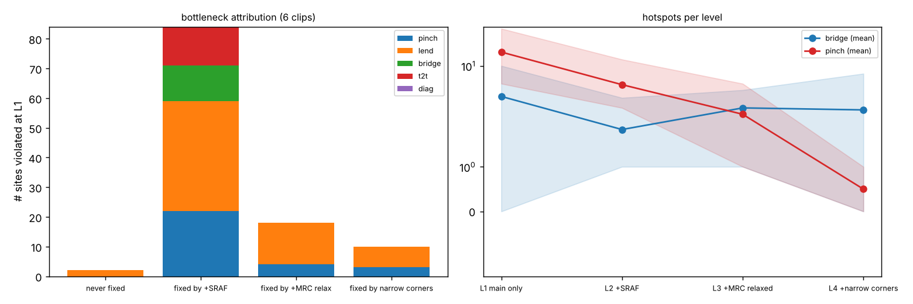

6 个版图,L1(只动主图形、冻结无 SRAF、R=8)上有 114 个违规站点:

| 第一次修好的级别 | 数量 |
|---|---|
| L2 +SRAF/外围自由度 | 84(74%) |
| L3 +放松 MRC(R 8→5) | 18(16%) |
| L4 +收窄工艺角(剂量 ±4%,mask ±0.75) | 10(9%) |
| 始终修不好 | 2(2%) |

- 修好后又在更高级别回退的只有 4 个。
- 但每放开一级,别处也可能冒出少量新违规(例如 seed1 放松 MRC 后,拓扑 bridge 从 1 个变成 3 个)。所以梯子用来**归因**很好用,但不保证单调改善。
- L4 是规格决策,不是 recipe 技巧,报告中单列。

### 3.10 E9:权重与步长的耦合 ⚠️
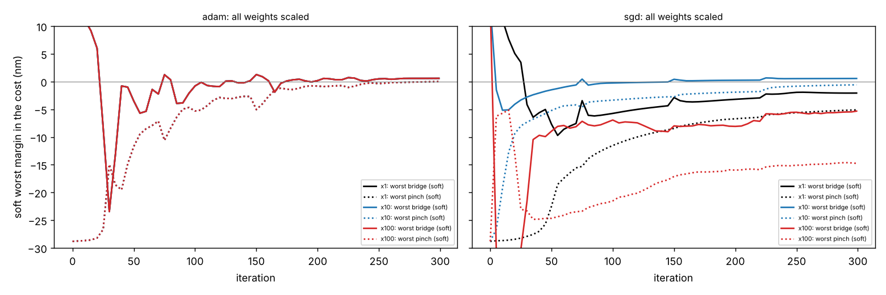

所有权重同时乘以 1/10/100:
- Adam:三次都是 5 个 hotspot,结果完全相同。Adam 对损失的整体缩放不变。
- 普通梯度下降(学习率标定为与 Adam 初始步长一致):19 / 4 / 33 个。×1 收敛不足,×10 刚好,×100 过冲(最差余量 −13/−15 nm)。

**含义:** 如果你们的引擎是"EPE × 反馈系数"这种 GD 式更新(OPC 常用,相关专利提到需要阻尼,以及按 MEEF 调整反馈系数来抑制振荡),加权确实等于加步长;如果是 Adam 或带线搜索的方法,就只有相对权重起作用。

### 3.11 E10:soft threshold 陡度 ⚠️
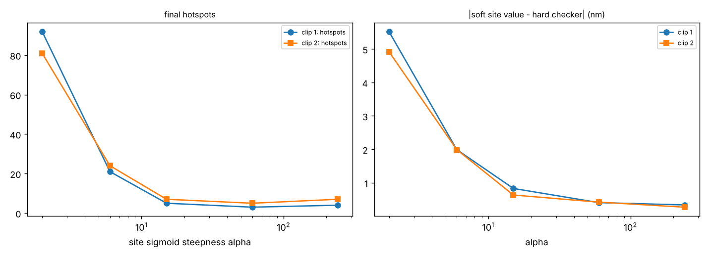

| α | 2 | 6 | 15 | 60 | 240 |
|---|---|---|---|---|---|
| 软/硬测量平均偏差 (nm) | 5.2 | 2.0 | 0.6~0.8 | 0.4 | 0.3 |
| hotspot(两个版图) | 92 / 81 | 21 / 24 | 5 / 7 | 3 / 5 | 4 / 7 |

太软的害处是确定的(cost 被欺骗);太陡只有轻微害处。**建议:先验证软测量与硬检查的偏差 ≤0.5 nm。**

### 3.12 E12:mask 误差角 ✅
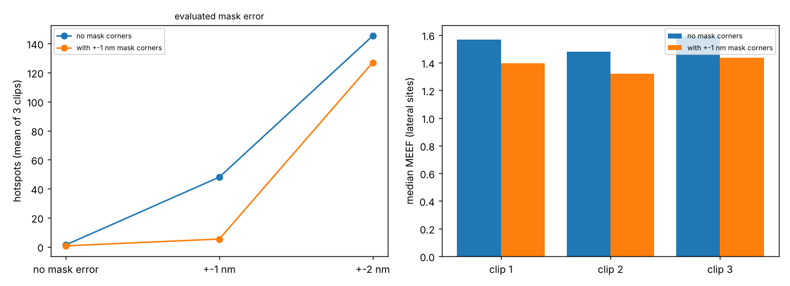

| 优化时 | 检查:无 mask 误差 | ±1 nm | ±2 nm | MEEF 中位数 |
|---|---|---|---|---|
| 不含 mask 角 | 3 / 0 / 1 | 48 / 43 / 53 | 138 / 136 / 162 | 1.57 / 1.48 / 1.59 |
| 含 ±1 nm mask 角 | 0 / 2 / 0 | **5 / 7 / 4** | 118 / 120 / 143 | 1.40 / 1.32 / 1.43 |

与 Pang 等(SPIE 7122,2008)把 MEEF 写进 ILT cost 的思路一致。结合 E1b:**在这个 pitch 下,mask 误差是余量预算的大头,所以这是最划算的一项改动。**

### 3.13 E13:hotspot 驱动的按站点加权 ⚠️
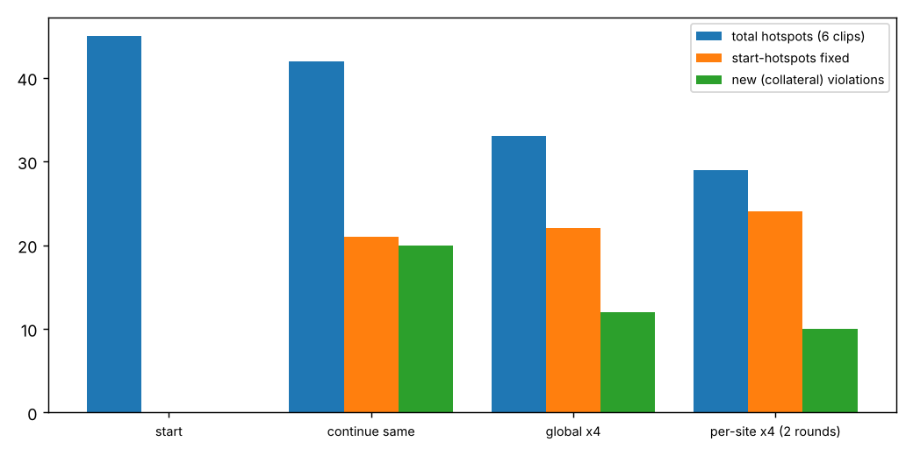

6 个版图合计,都是热启动后额外跑 200 次迭代:

| 策略 | 剩余 | 修好 | 新增违规 |
|---|---|---|---|
| 起点 | 45 | — | — |
| 原 recipe 继续跑 | 42 | 21 | 20 |
| 全局 ×4 | 33 | 22 | 12 |
| 违规站点 ×4(两轮) | **29** | 24 | **10** |

方向正确,但优势不大。**更重要的发现是"继续跑"这一行:后期的残余 hotspot 有大量随机翻腾。评价任何调参都要用多版图,并以"继续跑"作为对照。**

### 3.14 E14:cost 与检查器不一致 ✅
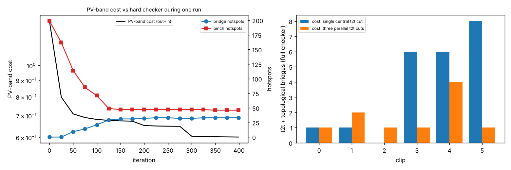

(a) 只用 PV-band 类 cost(外侧+内侧,权重各 2):

| 迭代 | 0 | 50 | 125 | 200 | 300 | 399 |
|---|---|---|---|---|---|---|
| PV-band cost | 1.37 | 0.71 | 0.68 | 0.65 | 0.61 | 0.60 |
| bridge | 0 | 9 | 29 | 32 | 32 | 33 |
| pinch | 199 | 114 | 49 | 47 | 47 | 46 |

从第 125 次迭代起,cost 又降了 12%,hotspot 一个都没少,同时 bridge 还在慢慢变多。

(b) cost 里的 T2T 采样:只用中心 cut vs 用三条平行 cut。检查器一律使用三条 cut 加拓扑检查(6 个版图合计):

| cost 的写法 | T2T 违规 | 拓扑 bridge | hotspot 总数 |
|---|---|---|---|
| 只用中心 cut | 15 | 7 | 44 |
| 三条平行 cut | **4** | 6 | 45 |

对齐后,这个盲区里的 T2T 违规减少了 73%,但总数没有变:省下来的违规转移成了 line-end 回缩违规。这又是 T2T 与回缩之间的加权和折中(见 §3.5)。**对齐检查器是必要条件,但不是充分条件。**

另外两个在搭建过程中发现的不一致:
- 一开始的检查器只有横向 cut 和中心 T2T cut,结果漏掉了"S 形桥接":线头被拉向侧面,桥接路径绕过了中心 cut。后来加上左右 ±8 nm 的平行 cut 和拓扑检查才抓到。
- 一个更严格的"禁入区/必含区"检查器,在 site 检查器报 0 个 bridge 的同一个解上,报出了 52~63 个违规块。**两种合理的检查器定义,结论可以相差一个数量级**,所以 cost 必须对齐你们实际签核用的检查器。

### 3.15 E15:minimax 能否推广到随机版图 ⚠️

6 个随机版图,每个 T2T gap 设为一个 minimax 组(3 条 T2T cut + 两侧 line-end),与加权和对比(合计):

| 写法 | bridge 权重 | hotspot 总数 | 组内违规 | 组外违规 | 拓扑 bridge |
|---|---|---|---|---|---|
| 加权和 | 10 | 45 | 31 | 8 | 6 |
| 加权和 | 100 | 48 | 31 | 10 | 7 |
| 每组 minimax | 10 | **43** | 32 | 3 | 8 |
| 每组 minimax | 100 | 46 | **17** | **26** | 3 |

- 权重 100 下,minimax 把组内违规减少了 45%,但组外违规增加了 16 个,主要集中在冲突最多的 seed5 和 seed6(2→11,6→10)。总数不变。
- 这与 E5b(孤立冲突,邻居 0 新增)形成对照:**冲突密集时,集中力量修冲突组会挤压其他位置**。这给"梯度黑洞"论点提供了中等强度的支持(要考虑 E13 测到的后期随机翻腾)。
- **实用建议:** minimax 作为**局部修补工具**(对残余的少数冲突点、只在局部窗口内用),而不是整版默认 cost。

### 3.16 E16:真正能改变对比度预算的自由度 ✅
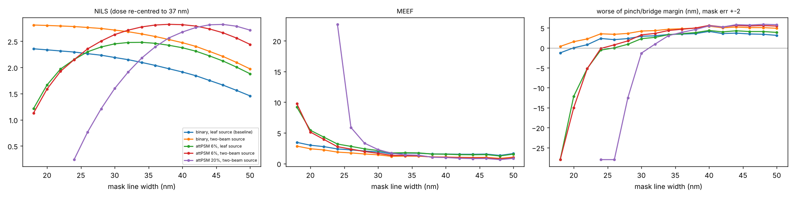

**原理:** 两束光成像下,对比度 γ = 2|a₀a₁| / (|a₀|² + |a₁|²),0 级与 1 级幅度相等时最大。二元 mask 只能靠缩窄线宽来压低 0 级,代价是 MEEF。另外两条路是:(1)attPSM 用带 π 相位的透光背景压低 0 级,不需要缩窄线宽;(2)把光源里"只有 0 级能进光瞳"的点去掉。在原来的 leaf 光源里,73 个点中有 22 个属于这一类,它们只贡献直流背景。

**A. 密集线**(剂量按每种 mask 宽度重新居中,印到 37 nm;工艺角:剂量 ±5%、焦距 ±40、mask ±2 nm):

| 组合 | 最佳 mask 宽度 | NILS | MEEF | pinch / bridge 余量 | 余量之和 |
|---|---|---|---|---|---|
| 二元 + leaf 光源(基线) | 40 | 1.91 | 1.55 | +4.14 / +4.11 | +8.25 |
| 二元 + 两束光光源 | 40 | **2.47** | **1.06** | +5.41 / +6.01 | **+11.42** |
| attPSM 6% + leaf 光源 | 40 | 2.38 | 1.52 | +4.54 / +4.34 | +8.89 |
| attPSM 6% + 两束光光源 | 40 | **2.82** | **1.03** | +5.61 / +6.31 | **+11.92** |
| attPSM 20% + 两束光光源 | 48 | 2.79 | **0.64** | +5.88 / +6.70 | **+12.58** |

**B. 随机版图上的完整 ILT**(参考 recipe,3 个版图):

| 组合 | hotspot | 合计 | 拓扑 bridge |
|---|---|---|---|
| 二元 + leaf 光源(基线) | 5 / 7 / 4 | 16 | 4 |
| 二元 + 两束光光源 | 2 / 1 / 2 | **5** | 0 |
| attPSM 6% + leaf 光源 | 4 / 2 / 0 | **6** | 2 |
| attPSM 6% + 两束光光源 | 1 / 0 / 0 | **1** | 0 |

结论:
- 与"窄 mask + 高剂量"(E1b)根本不同:这两种手段**同时抬高 NILS、降低 MEEF**,所以余量是净增加的。
- 光源修剪带来的 MEEF 下降最大(−32%)。原因在于背景点只贡献一个与 mask 宽度无关的直流项,它们稀释了图像对边缘位置的响应,却不稀释对 mask 尺寸误差的响应。
- 随机版图上,line-end 回缩也同样变好(4/4/3 → 2/1/2),原先担心修剪光源会伤害二维图形,在这里没有出现。
- attPSM 在密集线上的余量收益不大(+8%),但在随机版图上把 hotspot 从 16 降到 6,说明它对二维图形的帮助超过对密集线的帮助。
- **局限:** 标量模型,没有偏振(实际 NA 1.35 下 TE 偏振对这类线条的对比度影响很大);薄 mask,没有 attPSM 的 3D 效应(实际中会改变最佳透过率和偏置);光源只修剪了一种形状,没有做完整的 SMO;版图只有单向 metal。这些都属于 ILT 之外的工艺/掩模决策,需要和 SMO、mask 团队一起评估。

## 4. 扩展的调参法则目录(按来源标注)

标注说明:**[E#]** 本研究实验;**[文献]** 有文献支持;**[推理]** 仅为推理,未验证。

### A. cost 的写法
1. 用**站点级铰链**代替全局面积型或始终施压的惩罚:余量达标后梯度归零,安全位置不会被推向另一种缺陷。[E4]
2. 不要用 PV-band 作为主要指标去判断优化是否在进步,它可以一直下降而缺陷不变,甚至用 pinch 换 bridge。[E14]
3. cost 的采样位置必须覆盖检查器检查的所有位置,包括对角 line-end 到侧边、偏离中心的 T2T 路径;建议同时加拓扑检查。[E14、搭建过程]
4. 软测量的陡度要保证与硬检查的偏差 ≤0.5 nm;宁陡勿软。[E10]
5. 不要指望在 cost 里加对比度/ILS 项来"挖"出余量:在固定剂量和尺寸下,对比度已经贴近上限。[E1、E11]
6. 按站点加权的闭环有帮助,但收益不大;评价时一定要以"继续跑"和多版图作为对照。[E13]

### B. 工艺角
7. **优化时加入 mask CD 误差角**:在 mask 误差主导预算的场景下,这是最划算的一项。[E12、文献:Pang 2008]
8. 先拆解预算:剂量项、焦距项、mask 项各占多少。两束光成像下的密集线,焦距项可能很小,mask 项可能占大头。[E1b]
9. 收窄工艺角是规格决策,不是 recipe 技巧。但在归因时,它能区分"是真的超预算"还是"recipe 没挖尽"。[E8]

### C. 自由度
10. **最大的单项杠杆是主图形可以偏离目标多远**:把可修改范围从 14 nm 放宽到 40 nm,hotspot 就从 6/14/14 降到 3/8/4,与全自由相当;收益几乎全部在 line-end。检查你们 recipe 里限制主图形移动量和区域宽度的参数。[E7b、E8]
11. 在这个模型里,全自由 ILT **几乎不用独立 SRAF**,而是用与主图形相连的外扩(翼状结构、hammerhead、mask 上的亚分辨率连接)。所以"冻结 SRAF"本身影响有限,关键是有没有同时限制了主图形外扩。[E7、E7c]
12. 放在空 track 中心的"节距延续式"规则 bar 无效:在单向 metal 里,瓶颈在 line-end,而不在横向。[E7]
12b. 如果要冻结外围图形,用全自由 ILT 在代表性版图上生成,再规整化冻结,几乎没有损失。[E7]
13. 用"mask 偏置 + 剂量"去换 NILS,会被 MEEF 抵消,得不偿失。[E1b]
13b. **对比度要从光源和 mask 类型上要,不要从 mask 偏置上要。** 去掉光源里只贡献背景的点(在 74.5 nm pitch 下,就是不能同时让 0 级和 1 级进光瞳的点),以及使用 attPSM,都能同时抬 NILS、降 MEEF。本研究中 hotspot 16 → 5 → 1。[E16]
14. 放松 MRC 能修掉约 16% 的残余,但会在别处产生新风险(拓扑 bridge)。[E8]

### D. 优化器
15. 先弄清引擎用的是什么更新方式:GD 式反馈更新时,加权就等于加步长,需要阻尼或同步降低步长;Adam 类只看相对权重。[E9、文献:OPC 收敛相关专利]
16. 热启动后继续优化会产生大量随机翻腾(修 21 个、坏 20 个);最终结果要用独立的检查器签核,别只看最后一次迭代。[E13]

### E. 无解与诊断
17. 判断无解用 bias/gap 扫描或逐级松弛,**不要用梯度余弦**。[E2、E5、E6、E8]
17b. **"调遍权重都修不好" ≠ 无解。** 先换成 minimax/epigraph 形式,对冲突的那一组站点只推最差项。本研究里它在孤立冲突上找到了加权和在 3~300 所有权重下都找不到的可行解;但整版套用会把违规挤到别处,所以只适合作为局部修补工具。[E5b、E15、文献:多目标优化中加权和无法到达非凸 Pareto 前沿]
17c. **不要 cap 悬崖型约束**(T2T 短路这类拓扑失效),也不要全局 cap。[E5、E5b]
18. 悬崖型失效(T2T 短路)与渐变型失效(回缩)不对称,目标余量也应该不对称。[E2、E3、E5]
19. 局部灵敏度 = 1/ILS 被精确验证,可以用它快速估算每个站点能承受多大的扰动。[E3]
20. 测量方法本身会制造假象:用采样计数测长度会把灵敏度相关系数从 1.0 压到 0.4,必须用插值求交点。[E3]

### F. 未验证(仅推理)
21. 多分辨率优化、用规则 OPC 作初值、tile/halo 大小、优化模型与签核模型(核截断)不一致、PCGrad 类梯度投影。[推理]
22. 不对称的余量目标(T2T 目标余量设得比回缩大)。E2/E5 的现象支持这个方向,但没有单独做 A/B 实验。[推理]

## 5. 局限
- 标量成像、薄 mask、常阈值 resist、2D、单一光源、玩具版图。nm 级数值和计数只对这套设定有意义,**实验检验的是机制,不是你们产线的具体数值**。
- 每个结论一般基于 3~6 个版图;E13 显示后期噪声不小,某些小差异(例如 29 vs 33)不应过度解读。
- 检查器是 cutline + 拓扑,与你们的签核检查器不同;E14 已经说明检查器定义会显著影响结论。

## 6. 参考
- MEEF 写进 ILT/SMO cost:Pang et al., *Considering MEEF in inverse lithography technology (ILT) and source mask optimization*, Proc. SPIE 7122 (2008). https://ebooks.spiedigitallibrary.org/conference-proceedings-of-spie/7122/71221W/Considering-MEEF-in-inverse-lithography-technology-ILT-and-source-mask/10.1117/12.803801.full
- 滤波+投影、腐蚀/膨胀鲁棒设计与最小尺寸控制:Wang, Lazarov, Sigmund (2011),综述与实现见 https://pymoto.readthedocs.io/en/latest/auto_examples/topology_optimization/ex_compliance_robust.html 和 https://arxiv.org/pdf/2101.08605
- OPC 收敛中的阻尼、反馈系数与 MEEF:US7028284B2 https://patents.google.com/patent/US7028284 ,US7260812B2 https://patents.google.com/patent/US7260812
- line-end 回缩与 hammerhead 的桥接风险:https://journals.spiedigitallibrary.org/conference-proceedings-of-spie/6154/61543X/A-systematic-study-of-process-windows-and-MEF-for-line/10.1117/12.655475.full ,US6311319 https://patents.google.com/patent/US6311319
- PV-aware ILT:MOSAIC (DAC 2014) https://webarchive.lib.cuhk.edu.hk/20221209070306mp_/http:/www.cse.cuhk.edu.hk/~byu/papers/C26-DAC2014-MOSAIC-slides.pdf ;RMO-ILT (ICCAD 2024) https://personal.hkust-gz.edu.cn/yuzhema/papers/C38-ICCAD2024-PV-ILT.pdf
- bridging/pinching 约束 ILT:Kobelkov et al. 2015 及 Tritchkov 等后续工作 https://astronomicaltelescopes.spiedigitallibrary.org/conference-proceedings-of-spie/10147/101470Q/Resist-3D-aware-mask-solution-with-ILT-for-hotspot-repair/10.1117/12.2257962.full
